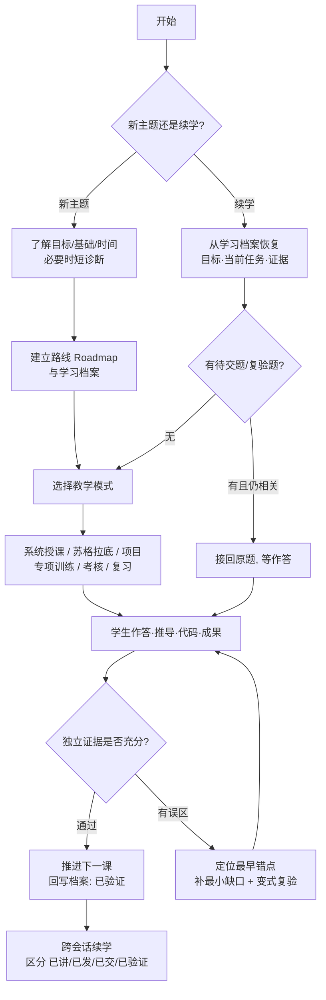

# 🎓 系统化学习导师 · Systematic Learning Tutor

**`systematic-learning` · Codex 用户级 Skill**

  
  
  
  

把一门课学下去，也把每次作答变成下一步的依据。适合想系统学一门课、接着旧学档继续、做专项训练，或通过项目练出可验证能力的人。

[快速开始](#快速开始) · [可以做什么](#可以做什么) · [工作流程](#工作流程) · [三个使用示例](#三个使用示例) · [学习档案](#学习档案) · [安装与调用](#安装与调用) · [文件结构](#文件结构)

---

## 快速开始

在你准备保存学习档案的 Codex 工作区里，复制一条适合现在的指令。主题、时间和目标越具体，第一轮越容易直接开工。

| 现在想做什么 | 可以这样说 | 这一轮会发生什么 |
| --- | --- | --- |
| 🌱 新学一门课 | `使用 $systematic-learning。我零基础，每周能学 3 小时，想用微积分解释简单的变化问题。今天直接开第一课。` | 建立或确认学习路线与档案，从合适的起点开始。需要判断水平时，先用短诊断收集证据。 |
| ▶️ 接着上次学 | `使用 $systematic-learning。读取这个工作区的 408 学档，从上次没完成的任务开始。` | 读进度和相关原题，接回待交任务，或按已经验证的前置能力开始下一课。 |
| 🔍 批改自己的解法 | `使用 $systematic-learning。请指出我最早出错的那一步，讲清原因，再给我一道独立复验题。下面是我的解法……` | 检查结论和过程，定位错误，布置一题检验同一个判断。长期主题会回写实际作答和下一步。 |
| ⏱️ 只练一个点 | `使用 $systematic-learning。我只有 20 分钟，想练链式法则。每次一题，等我答完再讲。` | 先出一题，等你作答，再根据理由决定给提示、补讲还是增加难度。 |

第一次使用时，**目标 + 已有基础 + 投入时间**通常就足以开始。做项目时可补上可用设备、数据或开发环境。恢复已有学档时，换工作区可以直接给原档案路径。

---

## 可以做什么

| 能力 | 适合的场景 | 你会得到什么 |
| --- | --- | --- |
| 系统授课 | 学高数、算法、语言、编程或一门工程技术 | 按前置知识排列的路线、循序讲解、代表例题与分层练习 |
| 苏格拉底引导 | 想自己推导公式、分析算法或想出解题方法 | 分步问题和逐级提示，留出独立思考空间 |
| 项目式学习 | 想通过一个实际任务练习，例如用 C++ 做命令行工具 | 项目里程碑、每阶段的实现任务和验收依据 |
| 专项训练 | 某一个题型或知识点反复出错 | 单项诊断、针对性讲解、逐步增难的变式 |
| 批改与考核 | 已有解答、推导、代码，或想做一次阶段测验 | 错因定位、实际证据与复验安排。正式考核先说明范围、规则和评分方式 |
| 复习与续学 | 学过一段时间，准备复盘或换一个会话继续 | 待交原题、优先复习点和可直接接手的下一步 |
| 快速答疑 | 只想弄清一个术语或具体问题 | 简明解释。普通单次问答无需建立学习工程 |

默认用中文教学，专业术语可附英文。一次学习过程中可以切换方式，例如先用系统授课理解原理，再改为一题一题的独立练习。

---

## 工作流程

导师不会盲目往下讲，而是**根据你的实际作答决定下一步**：补讲、复验，还是推进。

---

## 三个使用示例

### 1. 高数续学 · 用 20 分钟处理上次的误区

~~~text
使用 $systematic-learning，继续这个工作区的高数课。
昨天我把函数在该点的值和极限混在一起了。今天只有 20 分钟，
本来要学连续性。请先确认我能不能分清，等我作答再讲。
~~~

**这一轮**　如果已有适用的待交题，先接回原题。否则，导师会用一道短题分别检查点值和极限，并请你说明判断依据。

**接下来**　能独立答对并解释区别，就具备进入连续性的这项前置能力。关键理由仍有问题时，课时优先用来做针对性的对照与复验。未完成的任务记入学档，下一次可以接着做。

### 2. C++ 入门 · 从已有 Python 经验起步

~~~text
使用 $systematic-learning。我写过两年 Python，有 C++17 工具链。
想用八周做一个能处理文本的命令行工具，每周四小时。
我经常搞混 int 和 int&，请先用一个小程序诊断。
~~~

**这一轮**　先预测程序输出，并解释参数变化是否影响调用者。作答呈现的误区可用来调整首课和前两周安排。

**你能看到的成果**　可围绕命令行参数、文件处理、错误处理和边界测试设里程碑。每一阶段都有能独立完成的任务和可检查的结果。

### 3. 机器视觉项目 · 手边只有电脑

~~~text
使用 $systematic-learning。我想学机器视觉和机器人定位，
目前只有电脑，会一点 Python。请按六周项目安排，
先给我第一个离线任务、样本要求和验收条件。
~~~

**这一轮**　可以从合成图像和虚拟工作平面开始。导师会把目标拆成可单独验收的步骤，例如定位目标中心、验证坐标转换、检查结果能否复现。

**你能看到的成果**　每个里程碑有任务、样本和通过条件。使用合成数据、仿真和实物得到的证据会标出各自的来源。

---

## 学习档案

新建长期主题时，默认在当前可写工作区使用 `Learning/<主题标识>/`。如果工作区本身专用于这门课，可以直接沿用。已有主题继续使用原有路径、课次和记录格式。

~~~text
Learning/
└── <主题标识>/
    ├── StudentProfile.md    学习目标、基础和诊断证据
    ├── Roadmap.md           阶段目标、课程顺序和验收条件
    ├── Progress.md          当前任务、待交内容和下一步
    ├── Mistakes.md          实际错因和复验记录（按需）
    └── Exercises/           练习及答卷（按需）
~~~

有对应内容时，还可以保存课程、知识图、复习计划、成绩和项目里程碑。档案会区分**已经讲过、题已发出、已经提交、独立验证通过**。一道靠提示做对的题可以记录为练习证据，独立能力由随后的变式或解释验证。

要换一个会话时，说「继续上次的学习」并打开原工作区即可。换工作区时，附上原档案路径。只想在聊天中练习时，可以明确说「这次只在对话里练」。

---

## 安装与调用

把仓库克隆到当前用户的 Codex 技能目录。选用与你的终端匹配的命令。

**Windows · PowerShell**

~~~powershell
$skillDirectory = Join-Path $HOME '.agents/skills'
New-Item -ItemType Directory -Path $skillDirectory -Force | Out-Null
git clone https://github.com/Craftr66/systematic-learning.git (Join-Path $skillDirectory 'systematic-learning')
~~~

**macOS / Linux**

~~~bash
mkdir -p "$HOME/.agents/skills"
git clone https://github.com/Craftr66/systematic-learning.git "$HOME/.agents/skills/systematic-learning"
~~~

在任意学习工作区输入 `$systematic-learning`，再写下当前想完成的任务。显式调用适合需要指定教学模式或恢复学档时使用。

## 文件结构

~~~text
systematic-learning/
├── README.md      使用说明、可复制指令和示例
├── SKILL.md       Codex 加载的技能入口
├── agents/        技能显示名称和简介
├── references/    教学、评估、学习档案和各学科指南
├── assets/        课程路线、错题、考核等档案模板
└── examples/      高数、算法、C++ 和工程课例
~~~

本次改进细化了三件事：依据作答决定补讲或继续、用不同方式处理反复出现的误区、把待复验的题目和通过条件交给下一次会话。
